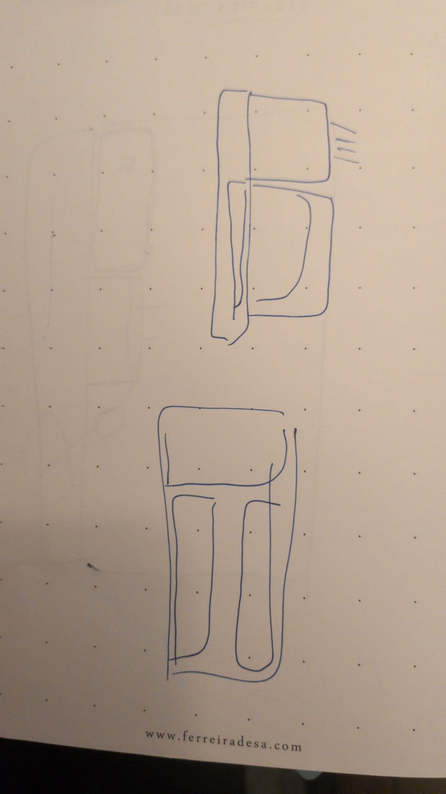

# Parametric Desk Organizer

A ribbed, oval desk organizer for 3D printing, with three sections: a pen cup, a book slot and a low post-it tray. Every section can be resized in an interactive Three.js viewer, which exports exactly what you see as an STL.



The sketch shows the side view (top drawing, for the heights) and the plan (bottom drawing, for where each section sits).

## Layout

```
  Plan                              Side view
  +-----------+--------+            books     ███████
  |   books   |        |            pens      ██████
  +-----------+  pens  |            post-its  ██
  |  post-its |        |
  +-----------+--------+
```

Default size: 200 × 100 × 95 mm, 102 half-round ribs. It fits a Bambu Lab A1 mini (180 mm plate) when rotated 45° in the slicer.

| Section  | Parameters                | Default                       |
|----------|---------------------------|-------------------------------|
| Pens     | length, height, depth     | 55 mm long, 90 mm tall, full  |
| Books    | width, height, depth      | 36 mm wide, 95 mm tall, full  |
| Post-its | height, depth             | 30 mm tall, full              |
| Overall  | length, width, rib width, shape, wall | 200 × 100 mm, 5 mm ribs, 3 mm wall |

"Depth" below full turns a section into a raised, shallow tray.

## Files

- `src/organizer-geom.js` – the parametric geometry. Builds a watertight mesh (Z-up, millimetres) and writes binary STL. Runs in the browser and in Node.
- `src/template.html` – the viewer UI. `/*__GEOM__*/` is replaced by the geometry module at build time.
- `dist/index.html` – the built, single-file viewer (loads Three.js r147 from jsDelivr).
- `scripts/` – build, STL export and mesh check.
- `examples/ribbed-organizer-200x100x95.stl` – the default design.

## Usage

```sh
npm install
npm run build                                   # writes dist/index.html
node scripts/export-stl.js                      # default STL into out/
node scripts/export-stl.js '{"pensH":100,"notesH":35,"booksW":40}'
pip install trimesh && python3 scripts/check_mesh.py out/*.stl
```

All parameters and their limits are in `DEFAULTS` and `resolveParams()` in `src/organizer-geom.js`.

## Printing

Print flat side down with no supports. Walls are 3 mm at the rib grooves, dividers 4.5 mm and floors 2.4 mm. Rims and pocket floors are rounded, and a 0.6 mm chamfer at the base helps against elephant's foot.

## License

MIT
